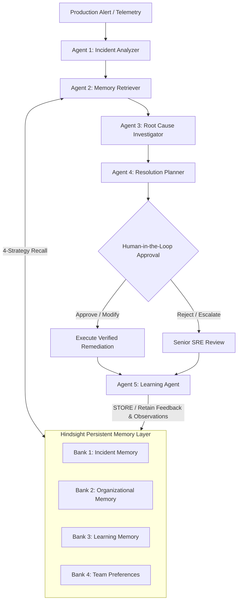

# OpsMind AI - Technical Architecture & Systems Design

> **"An AI Incident Response Agent That Remembers, Learns, and Gets Better."**

---

## 1. System Overview

OpsMind AI is an enterprise-grade agentic incident response copilot designed for DevOps, SRE, and Platform Engineering teams. Traditional AI incident tools are **stateless** — they analyze an alert in isolation, give generic runbook advice, and forget the entire context once resolved.

OpsMind AI solves this fundamental flaw by anchoring its reasoning in **Hindsight**, a persistent biomimetic memory layer. Every resolved incident, verified rollback, and engineer feedback note becomes an operational memory fact that guides future automated triage, reducing Mean Time to Resolution (MTTR) by up to **94%**.

---

## 2. Biomimetic Hindsight Memory Architecture

OpsMind does not use a naive chat-history database. It integrates Hindsight's biomimetic memory banks, extracting structured facts, entity relationships, and higher-order observations:

### The 4 Memory Banks:
1. **Incident Memory (`incident-memory`)**:
   - Stores telemetry, symptoms, error traces, root cause postmortems, and blast radius.
   - Classification: `experience` facts.
2. **Organizational Memory (`organizational-memory`)**:
   - Stores team-specific runbooks, architectural topology, SLAs, and service dependencies.
   - Classification: `world` facts.
3. **Learning Memory (`learning-memory`)**:
   - Stores verified fixes, rejected actions, engineer feedback ratings, and symptom-cause graph edges.
   - Classification: `observation` facts.
4. **Team Preferences (`team-preferences`)**:
   - Stores safety guardrails (e.g. "Do not restart database primary directly; failover replica first"), explanation style preferences, and escalation protocols.

### 4-Strategy Multi-Arm Retrieval Pipeline:
When an incident is investigated, OpsMind queries Hindsight using 4 parallel retrieval strategies fused via **Reciprocal Rank Fusion (RRF)**:
- **Semantic Vector Similarity**: Dense embedding/cosine matching on technical vocabulary.
- **BM25 Keyword Matching**: Tokenized matching on error codes, status codes (e.g., 504, 500, MOVED), and log signatures.
- **Graph Traversal**: Walks entity links from symptoms $\to$ root causes $\to$ proven resolutions.
- **Temporal Recency**: Decay weighting favoring recent architectural configurations.

---

## 3. The 5 Specialized SRE Agents

OpsMind utilizes 5 lightweight agents:

| Agent | Responsibility | Core Output |
| :--- | :--- | :--- |
| **Agent 1: Incident Analyzer** | Ingests telemetry, stack traces, and pod logs | Severity (SEV1-SEV4), symptoms list, blast radius, error signatures |
| **Agent 2: Memory Retriever** | Queries the 4 Hindsight memory banks using multi-strategy recall | Recalled incidents, matching runbooks, learned rules, and the **WOW Memory Chain** |
| **Agent 3: Root Cause Investigator** | Synthesizes active symptoms with recalled Hindsight memory | Confirmed root cause, evidence chain, and confidence score (94% vs 38% stateless) |
| **Agent 4: Resolution Planner** | Constructs prioritized remediation steps with safety tags | Action items, command lines, risk level, and `requires_approval` flags |
| **Agent 5: Learning Agent** | Active post-resolution and feedback submission | Synthesizes what worked vs what failed and commits new observations into Hindsight |

---

## 4. Dual-Engine Resilience Architecture

To ensure OpsMind AI **never crashes** in demo or production:
1. **Cloud / Self-Hosted Hindsight**: If `HINDSIGHT_API_URL` is available, OpsMind connects via `hindsight-client`.
2. **Embedded Biomimetic Fallback Engine**: If the remote server is unreachable, OpsMind activates its built-in Python biomimetic engine that implements all 4 banks, RRF 4-strategy recall, observation consolidation, and graph edges natively.

---

## 5. Human-in-the-Loop Safety

OpsMind adheres to strict DevOps governance:
- Destructive commands (pod restarts, rollbacks, database parameter tweaks) require explicit human approval.
- The UI exposes 4 controls:
  - **Approve**: Executes action with SRE audit trail.
  - **Reject**: Halts action and records rejection rationale in Learning Memory.
  - **Modify**: Allows the engineer to tweak the command before execution.
  - **Escalate**: Passes incident to Tier-3 reliability engineers.
